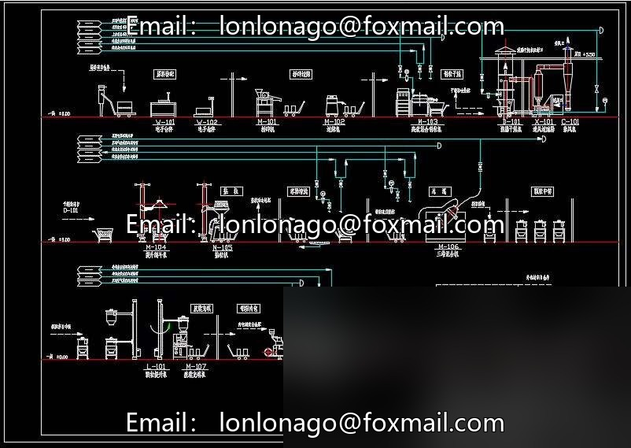
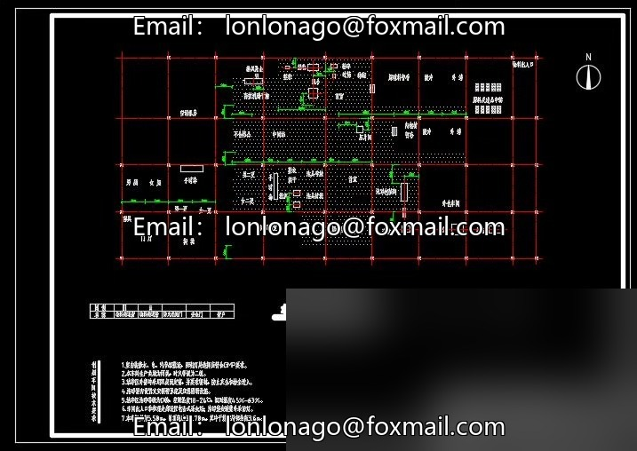
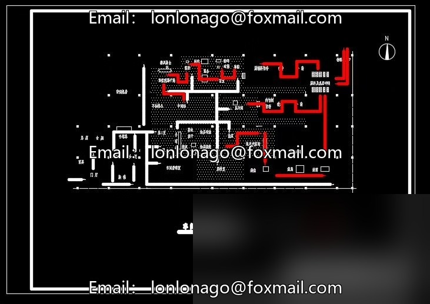
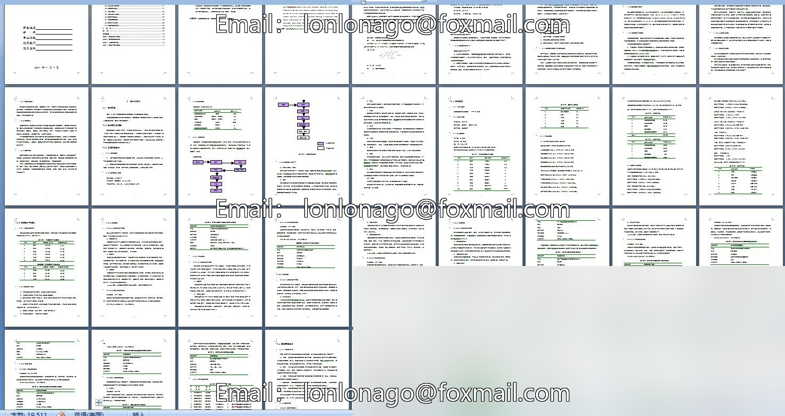

# 265. Capsule preparation process and workshop design; Capsule preparation process and workshop design drawing; Adhesive

## Body

265. Capsule preparation process and workshop design; Capsule preparation process and workshop design; Capsule preparation process and workshop design CAD drawing; Capsule preparation process and workshop design two-dimensional drawing

The material covers capsule preparation processes, workshop design, CAD diagrams and 2D diagrams.

<!-- AI_ENRICHED -->

## Images

## Payment

Here is a pay link on Stripe ( https://buy.stripe.com/3cs8yP7sY87d0vu9AB ). Please contact me lonlonago@foxmail.com after funding $89, and I will send you a complete data files , thank you!

